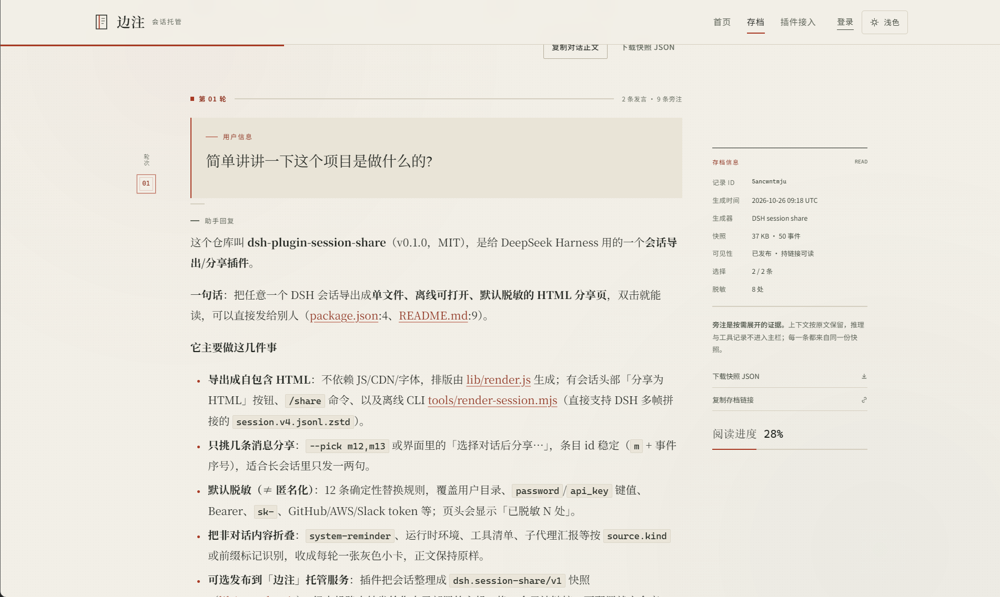
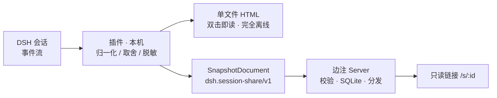
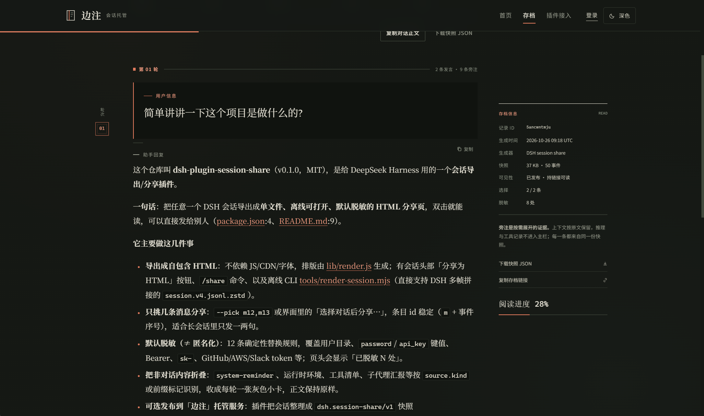

<div align="center">

# Session Share

**把一段 DSH 会话，变成一份可以发出去的文档。**

本地渲染 · 默认脱敏 · 单文件离线可读 · 可选托管为只读链接

[](package.json)
[](LICENSE)
[](package.json)
[](package.json)

</div>

<p align="center">
  
</p>

<p align="center"><sub>发布到「边注」托管服务后的阅读器：正文与旁注分层，右侧是快照元信息与阅读进度。</sub></p>

---

## 这是什么

DSH 的会话只活在本机。想把它发给别人时，截图太长、复制粘贴会丢格式、整份日志又太重。

这个插件做一件事：**在会话里把对话整理成一份可以独立存在的文档**。

- 默认产出**一份自包含 HTML** —— 不依赖 JS、CDN、字体，双击就能读，微信/邮件/IM 都能直接发。
- 如果自建了「边注」托管服务，也可以**发布成一条只读链接**，对方在浏览器里读，不用收文件。

整理过程全部在本机完成：解析事件流、区分真人对话和系统注入、折叠工具调用、按 12 条确定性规则脱敏。**脱敏发生在出网之前。**

## 两种交付形态

| | 单文件 HTML | 边注托管链接 |
| --- | --- | --- |
| 生成位置 | 本机 | 本机整理 → 上传结构化快照 |
| 对方怎么读 | 收到 `.html`，双击 | 打开一条 URL，只读 |
| 依赖 | 无（离线可用） | 需要你自建托管服务 |
| 适合 | 发文件、归档、离线留存 | 频繁分享、长期可访问、想随时撤回 |
| 撤回 | 发出去就收不回 | 发布者可随时撤回 |

## 它能做什么

| 能力 | 说明 |
| --- | --- |
| 导出单文件 HTML | 排版由 `lib/render.js` 生成，零外部资源，双击即读 |
| 只挑几条消息分享 | `--pick m12,m13` 或界面里的「选择对话后分享…」，条目 id 稳定可复用 |
| 默认脱敏 | 12 条确定性规则：家目录、`password` / `api_key` 键值、Bearer、`sk-`、GitHub / AWS / Slack 令牌；页头显示「已脱敏 N 处」 |
| 区分真人对话与系统注入 | `system-reminder`、运行时环境、工具清单、子代理汇报折叠成每轮一张灰色小卡，原文逐字保留 |
| 思考过程可控 | `--reasoning omit / count / full`，默认不展示 |
| 双主题 | 浅色 / 深色 / 跟随系统，分享页右上角可切换 |
| 发布到边注 | 整理成 `dsh.session-share/v1` 快照，上传后拿到只读链接 |
| 给 AI 用 | 离线 CLI 成功时只打印一行 JSON；另提供 `share_conversation_html` 工具 |

## 一条链路



托管端不解析 HTML、不重新脱敏、不猜语义：它只接收结构化快照并原样保存。所以阅读器看到的内容，和你在本机预览的内容是同一份。

---

## 快速开始

- **自己动手**：按下面三种方式之一装插件。
- **交给 AI 动手**：把 [docs/LLM.md](docs/LLM.md) 整份发给它——里面有分阶段闸门、禁止事项和交付报告模板；给人看的长版在 [docs/Deploy.md](docs/Deploy.md)。

**前提**：DSH 桌面端 ≥ `0.2.1-rc.2`。插件本身零运行时依赖。

### 方式 A · 插件市场索引（推荐）

在 DSH 打开「插件 → 发现」，添加索引源：

```text
https://raw.githubusercontent.com/CJXIAO0718/dsh-plugin-session-share/main/market/index.json
```

然后在市场里搜索 `Session Share` 安装。

> 「插件」页里没有「发现」标签时，说明市场 bundle 未启用（发行版默认不挂）；先启用再添加索引源，细节见 [docs/publish.md](docs/publish.md)。

### 方式 B · 按 git 地址安装

安装串就是一条 pnpm spec，commit 以 [`market/index.json`](market/index.json) 为准：

```text
git+https://github.com/CJXIAO0718/dsh-plugin-session-share.git#<40 位 commit>
```

> 钉 commit 而不是 `#main`：分支会漂移，重装一次行为就跟着变。

### 方式 C · 克隆到本地，用脚本挂载（开发者 / 离线）

```powershell
git clone https://github.com/CJXIAO0718/dsh-plugin-session-share.git
cd dsh-plugin-session-share
.\install.ps1 -WhatIf    # 先看它要写什么
.\install.ps1            # 写入 profile 的 cordis.patch.yml（自动备份）
```

> ⚠️ 同一台机器上**不要同时**用「方式 C 的本地挂载」和「方式 A/B 的市场安装」——同一个包名出现两个活动来源会让客户端组合失败，界面可能起不来。切换前先 `install.ps1 -Uninstall`。

### 装完必须重启

**完全退出 DSH（含托盘）再启动。** 客户端插件首次挂载只在进程启动时完成，热更新覆盖不到 `file://` 挂载的插件。

### 验证

1. 设置 → 插件，找到 id = `session-share-html`，确认 **phase 是 active**；
2. 打开任意会话，对话头部出现「**分享为 HTML**」按钮；
3. 点它 → 预览能出页面 / 下载得到文件，即通过。

### 万一 DSH 打不开了

客户端半包加载失败不是静默的，会让 web boot 拒绝启动。**有序三步**：

1. 完全关闭 DSH（确认进程退出）；
2. 双击 [`如果DSH起不来-双击我.cmd`](如果DSH起不来-双击我.cmd) —— 它把 `cordis.patch.yml` 回滚到安装前的备份；
3. 重新启动 DSH。

两个脚本都不会动你的会话、工作区或任何数据，只改 `cordis.patch.yml` 一个文件，且每次改前都再备份一份。完整说明与回滚细节见[部署指南](docs/Deploy.md#回滚)。

---

## 用法

| 用法 | 怎么做 | 适合 |
| --- | --- | --- |
| 会话头部按钮 | 点「分享为 HTML」→ 预览 / 下载 | 手边就是那个会话 |
| `/share` 命令 | 输入框敲 `/share`（可加 `preview` / `download` / `publish`） | 想快速在本机打开或下载 |
| 离线 CLI | `node tools/render-session.mjs --log <日志> --out <out.html>` | 批量、脚本、AI 调用、无桌面端 |
| 挑选部分对话 | 分享菜单 →「选择对话后分享…」勾几条，或 CLI `--pick m12,m13` | 会话很长，只想发其中一两句 |
| 发布到边注 | 分享菜单 →「发布到边注…」（首次先填「连接设置…」） | 已部署托管服务，想要只读链接 |

### 1）头部按钮与 `/share`

分享菜单有「预览」（新窗口打开）和「下载」。渲染在本地完成，不上传任何内容。

```
/share            按「连接设置」里选的默认行为执行（出厂：本机预览）
/share preview    本次改成【本机】预览地址（只有这台机器、这个已登录浏览器能打开）
/share download   本次改成【本机】下载（文件存下来后才可以发给别人）
/share publish    本次改成直接发布到边注（需先填主机地址与个人令牌）
```

默认行为在「连接设置…」顶部三选一，保存在 `$DSH_HOME/session-share/settings.json`（令牌同文件，权限 `0600`，接口不回传令牌明文）。

### 2）离线 CLI

```bash
node tools/render-session.mjs \
  --log <session.v4.jsonl.zstd 或 .jsonl> \
  --out <out.html> \
  [--reasoning omit|count|full] [--pick m12,m13] [--no-redact] [--title "标题"]
```

- 零外部依赖，唯一 import 是 `../lib/render.js`；被 `import` 复用时不会执行 CLI。
- 直接支持 DSH 的 `session.v4.jsonl.zstd`：它是多个 zstd 帧顺序拼接，CLI 按魔数逐帧解压。
- 成功时 stdout 只打印一行 JSON，失败时 stderr 一行中文错误：

```json
{"out":"C:\\...\\out.html","bytes":31022,"stats":{"events":96,"redact":true,"userMessages":9,"assistantMessages":9,"toolCalls":6,"turns":4,"picked":12,"totalEntries":12,"redacted":60}}
```

（上面是仓库夹具 `test/fixtures/session-sample.events.jsonl` 的实测值；真实会话的 `bytes` 与计数随长度变化。）

- 退出码：`0` 成功；`1` 运行失败（文件不存在 / 无事件 / 渲染抛错）；`2` 参数非法。
- 会话日志默认在 `%USERPROFILE%\.dsh\sessions\<工作目录编码>\<session-id>\session.v4.jsonl.zstd`。

### 3）只发其中几条

会话太长时，整份导出既不方便也不安全。这一种用法只把你勾选的消息发给别人。

- 入口：分享菜单第三项「**选择对话后分享…**」。
- 列表每行是勾选框 + 角色（你 / DeepSeek）+ 单行摘录（+ 时间）；摘录**在服务端就已脱敏**，不是浏览器里再截原文。
- 条目 id 形如 `m12`，只跟消息本身绑定：换主题、换 `--reasoning`、重新渲染都不变，可以直接记下来复用。
- 某轮只要有 ≥1 条消息被选中，这一轮的内联上下文灰卡与工具调用行仍照旧出现；脱敏、折叠规则不变。

```bash
node tools/render-session.mjs --log session.v4.jsonl.zstd --out out.html --pick m12,m13
```

命不中的 id 直接忽略；全不命中时输出一张「未选择任何消息」的空页，不是崩溃。

---

## 托管服务：边注

`server/` 是一个可独立部署的托管应用：**一个 Node 进程**同时提供网页、API 与 SQLite 存储，前端在构建阶段生成，运行时不需要 Vite、npm、独立数据库或前端服务常驻。它不随插件 npm 包发布，部署方从本仓库单独构建。

<p align="center">
  
</p>

<p align="center"><sub>同一份快照的深色主题；右侧可下载原始快照、复制只读链接。</sub></p>

### 一行起服务

```bash
cp server/.env.example .env      # 设置域名与管理员密码；本地 HTTP 测试把 MARGIN_SECURE_COOKIES 设为 0
docker compose -f compose.server.yml up -d --build
```

默认只映射到 `127.0.0.1:8787`，由反向代理接 HTTPS。生产配置、Nginx 示例、Node 直接运行、备份与回退见 [**部署指南**](docs/Deploy.md)。

### 关键环境变量

| 变量 | 默认 | 说明 |
| --- | --- | --- |
| `MARGIN_BASE_URL` | 由请求 Host 推导 | 生产设为外部 HTTPS 基地址 |
| `MARGIN_ADMIN_USERNAME` | `admin` | 首位管理员用户名 |
| `MARGIN_ADMIN_PASSWORD` | 随机生成 | 仅建号时生效；缺省时只在启动日志出现一次 |
| `MARGIN_SECURE_COOKIES` | 按 BASE_URL 推导 | HTTPS 自动启用；HTTP 测试用 `0` |
| `MARGIN_DB_PATH` | `data/margin.db` | Compose 中为 `/app/data/margin.db` |

默认策略：链接可访问 1 天，每人每分钟 8 次发布，每人 200 MiB，全站 5 GiB，单份快照最大 8 MiB —— 管理员可在站点设置里调整。

### 它是什么、不是什么

- **是**：邀请制账号、个人令牌、快照校验与存储、只读阅读器、撤回与恢复、管理员整体策略（容量 / 配额 / 保留期 / 上传节奏）。
- **不是**：没有"上传 HTML"入口，没有跨快照搜索，没有单条记录的代管 —— 撤回归发布者本人，管理员不介入单条分发决策。

<details>
<summary>页面一览（点开）</summary>

| 路径 | 访问 | 内容 |
| --- | --- | --- |
| `/` | 公开 | 主页：产品介绍、场景演示、示例记录、准入 |
| `/register` | 仅未登录 | 邀请码注册，用户名即显示名 |
| `/login` | 仅未登录 | 登录 |
| `/s/:id` | 公开 | 阅读器：正文、旁注抽屉、轮次导航、快照下载 |
| `/archive` | 登录后 | 我的分享：发布列表、撤回 / 恢复、配额与策略 |
| `/tokens` | 登录后 | 连接与令牌：生成 / 停用个人令牌、接入教程 |
| `/connect` | 公开 | 插件接入教程：主机地址、令牌与发布步骤 |
| `/admin` | 管理员 | 概览：发布节奏、最近记录、策略与容量 |
| `/admin/invites` | 管理员 | 邀请码：生成、复制、停用 |
| `/admin/people` | 管理员 | 成员管理：搜索、暂停、恢复 |
| `/admin/settings` | 管理员 | 系统设置：容量、保留期、上传节奏、准入 |
| `/api` | 公开 | 托管 API 约定（技术参考） |

</details>

### 打通插件与托管服务

1. 管理员登录 `/login`，在 `/admin/invites` 生成邀请码；
2. 成员用邀请码注册，在 `/tokens` 生成个人令牌（完整值只显示一次）；
3. 回到 DSH → 分享菜单 →「连接设置…」→ 填主机地址与令牌 →「保存并测试」；
4. 分享菜单 →「发布到边注…」→ 拿到只读地址。

连接设置保存到本机 `$DSH_HOME/session-share/settings.json`（令牌同文件，权限 `0600`），浏览器也保留 localStorage 缓存。设置接口不回传令牌明文，令牌不写进分享页、日志或 URL。浏览器调用本机同源路由，再由本机进程请求你填的主机，因此**不需要给边注配置 CORS**。

---

## 配置项

插件条目里的 `config`（由 `lib/index.js` 读取）：

| 键 | 取值 | 默认 | 说明 |
| --- | --- | --- | --- |
| `theme` | `auto` / `light` / `dark` | `auto` | 分享页初始主题 |
| `redact` | `true` / `false` | `true` | 脱敏总开关；`false` = 原样输出，慎用 |

```yaml
- insert:
    - id: session-share-html
      name: 'file:///C:/.../dsh-plugin-session-share/lib/index.js'
      config:
        theme: light
        redact: true
```

---

## 脱敏

默认开启，规则是**确定性纯文本替换**：同一输入永远得到同一输出，可重复执行。

| 类别 | 覆盖 |
| --- | --- |
| 家目录路径 | Windows `C:\Users\你\…`、MSYS `/c/Users/你/…`、macOS / Linux `/Users/你`、`/home/你` → `%USERPROFILE%` / `~` |
| 密钥键值 | `"password": "…"`、`api_key=…` → 值替换为 `[REDACTED]` |
| 身份令牌 | `Bearer …`、`sk-…`、`ghp_` / `gho_` / `ghu_` / `ghs_` / `ghr_`、`github_pat_…`、`AKIA…`、`xoxb-` / `xoxa-` / `xoxp-` → `[REDACTED:类型]` |

页头会显示「已脱敏 N 处」，数字来自实际替换次数。关闭方式：`config.redact: false` 或 CLI `--no-redact`。

<details>
<summary>12 条规则原文（点开）</summary>

| # | 规则 | 命中示例 | 替换为 |
| --- | --- | --- | --- |
| 1 | Windows 用户目录 | `C:\Users\alice\...` | `%USERPROFILE%` |
| 2 | MSYS / Git-bash | `/c/Users/alice/...` | `%USERPROFILE%` |
| 3 | macOS 家目录 | `/Users/alice/...` | `~` |
| 4 | Linux 家目录 | `/home/alice/...` | `~` |
| 5 | 带引号的密钥键值 | `"password": "hunter2"` | 值替换为 `[REDACTED]` |
| 6 | 裸密钥键值 | `api_key=abc123` | 值替换为 `[REDACTED]` |
| 7 | Bearer Token | `Bearer eyJhbGci...` | `Bearer [REDACTED:bearer]` |
| 8 | OpenAI 风格 Key | `sk-xxxx...` | `[REDACTED:sk]` |
| 9 | GitHub Token | `ghp_` / `gho_` / `ghu_` / `ghs_` / `ghr_` | `[REDACTED:github]` |
| 10 | GitHub 细粒度 Token | `github_pat_xxx` | `[REDACTED:github]` |
| 11 | AWS Access Key ID | `AKIA...` | `[REDACTED:aws]` |
| 12 | Slack Token | `xoxb-` / `xoxa-` / `xoxp-` | `[REDACTED:slack]` |

</details>

> **这是「脱敏」，不是「匿名化」。** 生成的文档里依然是**完整对话正文**：你说过的需求、贴过的代码、文件路径、命令输出、用户名、内网地址、业务数据……脱敏只覆盖上表那十几类模式。
>
> 发出去之前请自己打开看一眼，尤其是粘贴过日志 / 配置 / 密钥的会话。不确定就别发。单文件 HTML 不联网、无外部资源，但**文件本身自带全部内容——转发即等于公开**。

---

## 常见问题

**Q：插件页有 `session-share-html`、phase 也是 active，但会话头部没有按钮？**
大概率只是没重启。客户端插件首次挂载要重启进程；重启后仍然没有，再看插件页报错和浏览器控制台。

**Q：插件页压根没有这个 id？**
`cordis.patch.yml` 没写进去，或写成了裸行（裸行会被 warn 后丢弃）。用 `install.ps1 -WhatIf` 看应该写什么，再重跑安装。

**Q：`/share` 给我的地址发给别人打不开？**
正常。本机分享返回的是回环地址，且 `/api/*` 需要已登录的 owner 会话。要发给别人：用「下载」拿 `.html`，或配置边注主机后「发布到边注」。

**Q：点按钮一直转圈 / 报「分享失败」？**
打开 DevTools → Console 和 Network：`GET /api/session.shareHtml` 返回 404/500 说明插件没加载或渲染抛错（服务端日志会有 `[session-share-html]` 前缀）。预览空白但下载成功 = 浏览器拦截了弹窗。

**Q：发布失败会影响本机导出吗？**
不会。主机不可达、令牌无效、超出大小、限流都只影响这一次发布，本机预览与下载照常可用。

**Q：能导出以前的会话吗？**
能。CLI 直接读会话日志文件，不依赖桌面端运行。

更多故障排查、回滚、手工删条目见[部署指南](docs/Deploy.md#故障排查)。

---

## 文档地图

| 文档 | 给谁看 | 内容 |
| --- | --- | --- |
| [docs/Deploy.md](docs/Deploy.md) | 部署的人 | 插件安装、托管服务部署、联调、备份回退、排错 |
| [docs/LLM.md](docs/LLM.md) | AI Agent | 可执行的部署步骤、验证闸门、禁止事项、交付报告模板 |
| [docs/publish.md](docs/publish.md) | 发版的人 | GitHub + 市场索引的完整发版流程 |
| [docs/server.md](docs/server.md) | 摸代码的人 | 边注服务源码入口与文档索引 |
| [server/docs/HOSTING.md](server/docs/HOSTING.md) | 运维 | 生产部署、资源边界、数据维护 |
| [server/docs/API.md](server/docs/API.md) | 接入方 | 快照 API、错误码、`SnapshotDocument` 字段 |
| [server/docs/AUTH.md](server/docs/AUTH.md) | 接入方 | 登录、邀请码、角色、令牌与安全清单 |

## 目录结构

```text
dsh-plugin-session-share/
├─ lib/
│  ├─ index.js              # 插件注册：命令、路由、工具
│  ├─ client.js             # 会话头部「分享为 HTML」按钮
│  ├─ render.js             # 事件流 → 单文件 HTML
│  ├─ snapshot.js           # 事件流 → 原生 SnapshotDocument
│  └─ redact.js             # 脱敏规则
├─ tools/
│  ├─ render-session.mjs    # 离线 CLI
│  └─ make-index.mjs        # 生成市场索引
├─ server/                  # 边注托管应用（独立部署，Node ≥ 24）
├─ docs/
│  ├─ Deploy.md             # 部署指南（人）
│  ├─ LLM.md                # 部署指引（AI Agent）
│  ├─ publish.md            # 发版与市场索引
│  └─ server.md             # 托管服务入口
├─ install.ps1              # 一键安装 / 卸载 / -WhatIf
├─ restore-if-broken.ps1    # 应急回滚
├─ cordis.patch.yml         # 包内 bundle patch
└─ compose.server.yml       # 托管服务 Compose 入口
```

## 边界与限制

- 只在 Windows + PowerShell 5.1 上验证过两个 `*.ps1`；脚本必须保存为 UTF-8 with BOM。
- `.zstd` 解码依赖 Node 内置 zstd（Node ≥ 22.15）；Node 20 上只能喂未压缩的 `.jsonl`。
- 分享页是静态快照：生成之后会话再变化不会自动更新。
- 子代理正文不展开，内部事件只按类型计数折叠。
- 托管服务是单实例 SQLite 模式，不支持多容器共写同一个库。
- 桌面端运行时 `dsh --profile desktop --dump-config` 会被拒绝，这不是配置错误。

## License

[MIT](LICENSE) © CJXIAO0718
